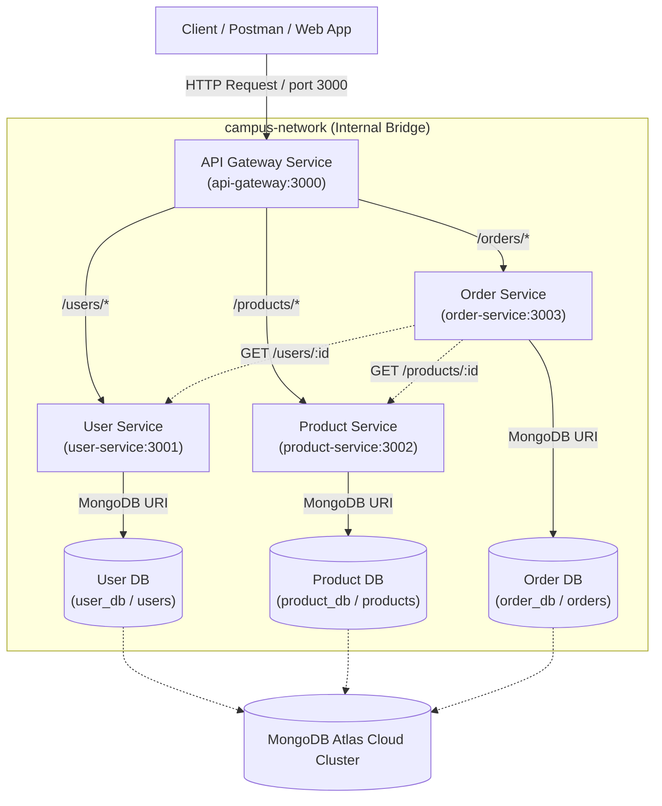

# Web Services & SOA — Lab 7 & Lab 8
## Lab 7: API Gateway, Service Discovery & Cloud Deployment
## Lab 8: Kubernetes Orchestration, CI/CD & Monitoring

## 1. Project Overview & Lab 7 Objectives

This project builds upon the CampusConnect microservices architecture developed in Lab 6. In Lab 7, we introduce a central **API Gateway**, **configuration-based service discovery**, and **cloud deployment readiness for Render and MongoDB Atlas**.

### Key Lab 7 Objectives:
* **API Gateway Pattern**: Implement a unified entry point service using Node.js, Express, and `http-proxy-middleware`.
* **Security & Network Isolation**: Expose only host port `3000` for the API Gateway while keeping backend microservices (`user-service`, `product-service`, `order-service`) isolated inside the internal Docker network (`campus-network`).
* **Configuration-Based Service Discovery**: Route requests dynamically using environment variables (`USER_SERVICE_URL`, `PRODUCT_SERVICE_URL`, `ORDER_SERVICE_URL`) without hardcoding URLs in gateway source code.
* **Centralized Logging & Resilience**: Log HTTP method, request path, target service, response status code, and response duration at the gateway level. Return clean `503 Service Unavailable` JSON responses when downstream services fail.
* **Cloud & Atlas Readiness**: Bind all services to `0.0.0.0`, listen on `process.env.PORT`, and configure MongoDB Atlas database connection URIs.

---

## 2. Architecture Diagram



---

## 3. API Gateway Discussion & Rationale

### Why Use a Single API Gateway?
In microservices architecture, allowing clients to call individual microservices directly creates security vulnerabilities, tight coupling, and complex client code. A single API Gateway solves these problems by providing:

1. **Single Public Entry Point**: Clients interact exclusively with one base URL (`http://localhost:3000` locally or `https://<api-gateway-app>.onrender.com` in the cloud).
2. **Encapsulated Internal Network**: Hides internal microservice hostnames, container topology, and port numbers from external clients.
3. **Centralized Request Logging**: Consolidates request tracking into a single standard log output.
4. **Centralized Error Handling**: Intercepts downstream connection failures and returns clean HTTP error responses (`503 Service Unavailable`) instead of leaking internal error details or hanging client connections.

### Gateway Logging Details
For every incoming request, the gateway logs:
* **HTTP Method** (e.g., `GET`, `POST`, `PUT`, `DELETE`)
* **Request Path** (e.g., `/users/101`)
* **Target Microservice** (e.g., `User Service (http://user-service:3001)`)
* **Response Status Code** (e.g., `200`, `201`, `404`, `503`)
* **Processing Duration** (e.g., `12ms`)

*Sample Terminal Log:*
```text
[GATEWAY LOG] GET /health -> Target: Gateway | Status: 200 (4ms)
[GATEWAY LOG] POST /users -> Target: User Service (http://user-service:3001) | Status: 201 (18ms)
[GATEWAY LOG] GET /orders -> Target: Order Service (http://order-service:3003) | Status: 200 (6ms)
```

---

## 4. Error Handling (404 and 503 Responses)

### 1. Unmapped Gateway Route (404 Not Found)
When a request is sent to a route not mapped by the gateway (e.g., `GET /non-existent-route`), the gateway returns a clean `404 Not Found` JSON payload:
```json
{
  "error": "Not Found",
  "message": "No gateway route found for GET /non-existent-route"
}
```

### 2. Microservice Down / Unreachable (503 Service Unavailable)
If a targeted microservice is stopped, crashed, or unreachable, `http-proxy-middleware` catches the proxy connection error and returns a clean `503 Service Unavailable` JSON payload:
```json
{
  "error": "Service Unavailable",
  "message": "The User Service is currently unreachable at http://user-service:3001.",
  "targetService": "User Service",
  "status": 503,
  "timestamp": "2026-10-03T19:50:00.000Z"
}
```

---

## 5. Configuration-Based Service Discovery

### Static vs. Dynamic Service Discovery
* **Configuration-Based / Static Discovery (Used in Lab 7)**:
  Service target locations are configured via environment variables (`USER_SERVICE_URL`, `PRODUCT_SERVICE_URL`, `ORDER_SERVICE_URL`). The gateway reads these values from `config.js` without requiring hardcoded URLs inside proxy route code. This allows changing service locations between local development, Docker Compose, and cloud deployment seamlessly.
* **Dynamic Service Discovery (Consul, Eureka, Kubernetes DNS)**:
  Microservice instances register themselves automatically with a service discovery registry upon startup and deregister upon shutdown.
* **What Dynamic Discovery Provides Beyond Static Config**:
  * Real-time automatic registration/deregistration of scaling instances.
  * Active heartbeat health checks to route traffic away from unhealthy nodes.
  * Dynamic client-side and server-side load balancing across autoscaled instances.

---

## 6. API Gateway Routes Table

All client requests must be sent to the API Gateway on port `3000` (or the cloud gateway URL).

| Client Request Path | Target Microservice | Destination URL | Purpose |
| :--- | :--- | :--- | :--- |
| `GET /health` | **API Gateway** | Internal Handler | Gateway status & route health check |
| `/users/*` | **User Service** | `USER_SERVICE_URL` | User management CRUD endpoints |
| `/products/*` | **Product Service** | `PRODUCT_SERVICE_URL` | Product catalog CRUD endpoints |
| `/orders/*` | **Order Service** | `ORDER_SERVICE_URL` | Order processing endpoints |

### Endpoints List
* **Gateway**: `GET /health`
* **Users**: `POST /users`, `GET /users`, `GET /users/:id`, `PUT /users/:id`, `DELETE /users/:id`
* **Products**: `POST /products`, `GET /products`, `GET /products/:id`, `PUT /products/:id`, `DELETE /products/:id`
* **Orders**: `POST /orders`, `GET /orders`, `GET /orders/:id`

---

## 7. Docker Compose & Internal Networking

In `docker-compose.yml` (and `compose.yaml`), internal network security is enforced:
* **Gateway Port Exposure**: Only `api-gateway` maps a host port (`3000:3000`).
* **Microservice Isolation**: `ports:` mappings are removed from `user-service`, `product-service`, and `order-service`.
* **Service Name Routing**: Microservices communicate internally on the `campus-network` bridge using container service names:
  * `USER_SERVICE_URL=http://user-service:3001`
  * `PRODUCT_SERVICE_URL=http://product-service:3002`
  * `ORDER_SERVICE_URL=http://order-service:3003`

---

## 8. Environment Variables Reference

| Service | Environment Variable | Example Value (Local / Docker) | Purpose |
| :--- | :--- | :--- | :--- |
| **`api-gateway`** | `PORT` | `3000` | Gateway listening port |
| | `USER_SERVICE_URL` | `http://user-service:3001` | Target URL for `/users` |
| | `PRODUCT_SERVICE_URL` | `http://product-service:3002` | Target URL for `/products` |
| | `ORDER_SERVICE_URL` | `http://order-service:3003` | Target URL for `/orders` |
| **`user-service`** | `PORT` | `3001` | Service listening port |
| | `MONGODB_URI` | `mongodb://user-db:27017/user_db` | MongoDB connection URI |
| **`product-service`** | `PORT` | `3002` | Service listening port |
| | `MONGODB_URI` | `mongodb://product-db:27017/product_db` | MongoDB connection URI |
| **`order-service`** | `PORT` | `3003` | Service listening port |
| | `MONGODB_URI` | `mongodb://order-db:27017/order_db` | MongoDB connection URI |
| | `USER_SERVICE_URL` | `http://user-service:3001` | Inter-service User validation URL |
| | `PRODUCT_SERVICE_URL` | `http://product-service:3002` | Inter-service Product validation URL |

---

## 9. MongoDB Atlas Cloud Database Setup

The project uses **one MongoDB Atlas cluster** housing **three distinct databases**:
1. `user_db` → `users` collection (Managed by User Service)
2. `product_db` → `products` collection (Managed by Product Service)
3. `order_db` → `orders` collection (Managed by Order Service)

### Cloud MongoDB URI Format (Configured on Render)
* **User Service**: `mongodb+srv://<username>:<password>@<cluster>/user_db?retryWrites=true&w=majority`
* **Product Service**: `mongodb+srv://<username>:<password>@<cluster>/product_db?retryWrites=true&w=majority`
* **Order Service**: `mongodb+srv://<username>:<password>@<cluster>/order_db?retryWrites=true&w=majority`

---

## 10. Render Cloud Deployment Settings

When deploying to **Render**, create 4 separate Web Services with the following build, start, and health-check configurations:

| Service Name | Root Directory | Build Command | Start Command | Health Check Path | Required Environment Variables |
| :--- | :--- | :--- | :--- | :--- | :--- |
| **`user-service`** | `user-service` | `npm install` | `npm start` | `/` | `PORT`, `MONGODB_URI` |
| **`product-service`** | `product-service` | `npm install` | `npm start` | `/` | `PORT`, `MONGODB_URI` |
| **`order-service`** | `order-service` | `npm install` | `npm start` | `/` | `PORT`, `MONGODB_URI`, `USER_SERVICE_URL`, `PRODUCT_SERVICE_URL` |
| **`api-gateway`** | `api-gateway` | `npm install` | `npm start` | `/health` | `PORT`, `USER_SERVICE_URL`, `PRODUCT_SERVICE_URL`, `ORDER_SERVICE_URL` |

---

## 11. Local & Cloud Testing Instructions

### Local Testing (Docker Compose)
1. Build and start containers:
   ```bash
   docker compose up --build -d
   ```
2. Verify container status:
   ```bash
   docker compose ps
   ```
3. Test Gateway health:
   ```bash
   curl http://localhost:3000/health
   ```

### Postman Testing (Local & Cloud)
1. Import `Lab7_APIGateway.postman_collection.json` into Postman.
2. The collection includes a collection variable named `gatewayUrl`:
   * **Local Testing**: Set `gatewayUrl` to `http://localhost:3000`.
   * **Cloud Testing**: Set `gatewayUrl` to your deployed Render URL (e.g., `https://<your-api-gateway-app>.onrender.com`).
3. Run the requests sequentially:
   * `1. Gateway Health Check (GET /health)`
   * `2. User Service - Create Initial User (POST /users)`
   * `3. User Service - Get All Users (GET /users)`
   * `7. Product Service - Create Initial Product (POST /products)`
   * `8. Product Service - Get All Products (GET /products)`
   * `12. Order Service - Create Order (POST /orders)`
   * `13. Order Service - Get All Orders (GET /orders)`
   * `15. Gateway Error Handling - Invalid Route (GET /non-existent-route)` → Expects `404 Not Found`
   * `16. Gateway Error Handling - Service Unavailable` → Expects `503 Service Unavailable`

---

## 12. Explanation: Empty MongoDB Atlas Databases

When microservices are first deployed to a fresh MongoDB Atlas cluster:
* `GET /users`, `GET /products`, and `GET /orders` will return `[]` (empty array) with HTTP status `200 OK`.
* **This is completely expected behavior** because a new Atlas database contains no documents yet.
* Executing `POST /users`, `POST /products`, and `POST /orders` will automatically create the collections in Atlas and insert documents. Subsequent `GET` requests will then return the populated data.

---

## 13. Troubleshooting Guide

| Issue | Cause | Solution |
| :--- | :--- | :--- |
| **`503 Service Unavailable`** | Target microservice is offline or `USER_SERVICE_URL` is wrong | Check target service status and verify service URL env vars. |
| **`querySrv ECONNREFUSED` / Atlas Connection Failed** | MongoDB Atlas IP whitelist blocking connection or DNS SRV issues | Add `0.0.0.0/0` (Allow access from anywhere) in MongoDB Atlas Network Access rules. |
| **`EADDRINUSE` Port Conflict** | Port 3000, 3001, 3002, or 3003 is already in use locally | Terminate lingering node processes or update local port settings. |
| **Direct Microservice Access Fails** | Host ports were intentionally unmapped for security compliance | Route all requests through API Gateway (`http://localhost:3000`). |

---

## 14. Student Reflection

In Lab 6, client applications connected directly to individual microservices on separate host ports (`:3001`, `:3002`, `:3003`), exposing internal architecture and requiring clients to manage multiple URLs. In Lab 7, we implemented a centralized API Gateway on port `3000` that serves as a single entry point for all client requests. By adopting configuration-based service discovery using environment variables, target microservice locations can be updated dynamically without altering gateway source code. Unmapping microservice host ports enforces internal network security, while centralized request logging and structured 503 error handling significantly improve overall system observability, resilience, and cloud readiness.

---

## 15. Submission Evidence Checklist

- [ ] **Docker Compose Running**: Screenshot of `docker compose ps` showing containers running with only `api-gateway` exposing port 3000.
- [ ] **Gateway Health Check**: Screenshot of `GET http://localhost:3000/health` returning `200 OK`.
- [ ] **Gateway → User Service**: Screenshot of `GET http://localhost:3000/users` returning user list.
- [ ] **Gateway → Product Service**: Screenshot of `GET http://localhost:3000/products` returning product list.
- [ ] **Gateway → Order Service**: Screenshot of `POST http://localhost:3000/orders` returning created order (`201 Created`).
- [ ] **Request Logging**: Terminal screenshot showing `[GATEWAY LOG]` entries printed during request routing.
- [ ] **Unreachable Service Error Handling**: Screenshot of `GET http://localhost:3000/users` returning `503 Service Unavailable` when `user-service` is stopped.
- [ ] **Service Discovery Proof**: Screenshot/log showing environment variable changing target service location dynamically.

---
---

# PART II — Lab 8: Kubernetes Orchestration, CI/CD & Monitoring

## 16. Lab 8 Overview & Architecture

Lab 8 evolves the Lab 7 CampusConnect API Gateway and microservices architecture into an automated, highly-scalable, production-ready cloud-native deployment. We package each service into immutable container images, orchestrate them inside **Kubernetes** under the `lab8` namespace, implement configuration via **ConfigMaps** and **Secrets**, enable **horizontal scaling** and **self-healing**, automate build and testing with **GitHub Actions CI/CD**, and deploy an end-to-end monitoring stack with **Prometheus** and **Grafana**.

### Lab 8 Architecture Diagram

```mermaid
flowchart TD
    Client["Client / Postman / Browser"] -->|Public Access: Port 3000 / NodePort 30080| GatewaySvc["api-gateway Service\n(type: NodePort :30080)"]

    subgraph GitHub_Actions ["CI/CD Automation (GitHub Actions)"]
        Repo["Git Repository Push / PR"] --> CI["GitHub Actions Workflow (.github/workflows/ci.yml)"]
        CI --> Test["npm test (Syntax & Smoke Tests)"]
        CI --> ValidateK8s["Kubernetes Manifest Validation (dry-run & kind)"]
        CI --> Build["Build Docker Images (Buildx)"]
        CI --> Registry[("Container Registry\nGHCR / Docker Hub\nTagged: git-SHA & latest")]
    end

    subgraph K8s_Namespace ["Kubernetes Cluster: namespace 'lab8'"]
        GatewaySvc --> GatewayPods["API Gateway Pods\n(:3000 /health /metrics)"]
        
        GatewayPods -->|DNS: user-service:3001| UserSvc["user-service (ClusterIP)"]
        GatewayPods -->|DNS: product-service:3002| ProductSvc["product-service (ClusterIP)"]
        GatewayPods -->|DNS: order-service:3003| OrderSvc["order-service (ClusterIP)"]

        UserSvc --> UserPods["User Service Pods\n(Replicas: 1 to 3)\n(:3001 /health /metrics)"]
        ProductSvc --> ProductPods["Product Service Pods\n(:3002 /health /metrics)"]
        OrderSvc --> OrderPods["Order Service Pods\n(:3003 /health /metrics)"]

        OrderPods -.->|DNS: user-service:3001| UserSvc
        OrderPods -.->|DNS: product-service:3002| ProductSvc

        Config["ConfigMap: app-config\n(Ports, Service URLs)"] -.->|env injection| GatewayPods
        Config -.->|env injection| UserPods
        Config -.->|env injection| ProductPods
        Config -.->|env injection| OrderPods

        Secrets["Secret: app-secrets\n(MongoDB URIs)"] -.->|env injection| UserPods
        Secrets -.->|env injection| ProductPods
        Secrets -.->|env injection| OrderPods
    end

    subgraph Monitoring_Stack ["Observability Stack (namespace 'lab8')"]
        Prometheus["Prometheus Server\n(prom/prometheus:v2.51.0\nNodePort: 30090)"]
        Grafana["Grafana Dashboard\n(grafana/grafana:10.4.1\nNodePort: 30300)"]

        Prometheus -->|Scrape GET /metrics (every 5s)| GatewayPods
        Prometheus -->|Scrape GET /metrics (every 5s)| UserPods
        Prometheus -->|Scrape GET /metrics (every 5s)| ProductPods
        Prometheus -->|Scrape GET /metrics (every 5s)| OrderPods

        Grafana -->|PromQL queries| Prometheus
    end

    UserPods ==>|TLS Connection| Atlas[("MongoDB Atlas Cloud Database\n(user_db, product_db, order_db)")]
    ProductPods ==>|TLS Connection| Atlas
    OrderPods ==>|TLS Connection| Atlas
```

---

## 17. Prerequisites & Environment Setup

Ensure the following tools are installed:
* **Node.js**: v18+ or v20+ (`node -v`)
* **Docker**: Docker Desktop, Minikube, or any standard OCI container engine (`docker --version`)
* **Kubectl**: Kubernetes CLI v1.26+ (`kubectl version --client`)
* **Kubernetes Cluster**: Docker Desktop Kubernetes, Minikube (`minikube start`), KinD (`kind create cluster`), or managed cloud (GKE/EKS/AKS).

### Cluster Verification Commands
```bash
# Check current Kubernetes context
kubectl config current-context

# Verify cluster connectivity
kubectl cluster-info

# Check cluster nodes
kubectl get nodes -o wide
```

---

## 18. Lab 8 Directory & Configuration Structure

```text
student-api/
├── .github/
│   └── workflows/
│       └── ci.yml                           # GitHub Actions CI/CD Pipeline
├── k8s/
│   ├── 00-namespace.yaml                    # Defines 'lab8' namespace
│   ├── 01-configmap.yaml                    # Non-sensitive config & Service DNS names
│   ├── 02-secrets.yaml                      # Kubernetes secret with Atlas URIs (git-ignored)
│   ├── 02-secrets.yaml.example              # Secret template for reference
│   ├── api-gateway.yaml                     # Gateway Deployment & NodePort Service (:30080)
│   ├── user-service.yaml                    # User Service Deployment & ClusterIP Service (:3001)
│   ├── product-service.yaml                 # Product Service Deployment & ClusterIP Service (:3002)
│   ├── order-service.yaml                   # Order Service Deployment & ClusterIP Service (:3003)
│   └── monitoring/
│       ├── 01-prometheus-configmap.yaml     # Prometheus scrape configuration
│       ├── 02-prometheus.yaml               # Prometheus Deployment & Service (:30090)
│       ├── 03-grafana-datasources.yaml      # Grafana automated datasource provisioning
│       ├── 04-grafana.yaml                  # Grafana Deployment & Service (:30300)
│       └── grafana-dashboard.json           # Pre-built monitoring dashboard
├── scripts/
│   ├── validate-k8s.js                      # Offline Kubernetes manifest validator
│   ├── test-gateway.js                      # Automated gateway API route tests
│   ├── generate-traffic.js                  # Automated HTTP traffic generator
│   ├── k8s-deploy.ps1 / .sh                 # One-click deployment script
│   └── k8s-scale-healing.ps1 / .sh          # One-click scaling & self-healing demo
├── api-gateway/                             # API Gateway source & Dockerfile
├── user-service/                            # User microservice source & Dockerfile
├── product-service/                         # Product microservice source & Dockerfile
└── order-service/                           # Order microservice source & Dockerfile
```

---

## 19. Docker Images: Building & Tagging

Each microservice contains a production-ready `Dockerfile`. Build and tag the images locally before applying manifests:

```bash
# 1. API Gateway
docker build -t api-gateway:latest ./api-gateway

# 2. User Service
docker build -t user-service:latest ./user-service

# 3. Product Service
docker build -t product-service:latest ./product-service

# 4. Order Service
docker build -t order-service:latest ./order-service
```

> **Minikube Note:** If using Minikube, execute `eval $(minikube docker-env)` (or `& minikube -p minikube docker-env --shell powershell | Invoke-Expression` in PowerShell) prior to building so images are stored inside the Minikube Docker daemon.

---

## 20. Kubernetes Secrets Safe Configuration

Sensitive database credentials (MongoDB Atlas connection strings) are injected exclusively via Kubernetes Secrets.

1. `k8s/02-secrets.yaml` is added to `.gitignore` to prevent committing secrets to GitHub.
2. A template is provided in `k8s/02-secrets.yaml.example`.
3. You can apply the secret directly or generate it via CLI:

```bash
kubectl create secret generic app-secrets \
  --namespace=lab8 \
  --from-literal=MONGODB_URI_USER="mongodb+srv://<username>:<password>@cluster0.lz9fhzb.mongodb.net/user_db?retryWrites=true&w=majority" \
  --from-literal=MONGODB_URI_PRODUCT="mongodb+srv://<username>:<password>@cluster0.lz9fhzb.mongodb.net/product_db?retryWrites=true&w=majority" \
  --from-literal=MONGODB_URI_ORDER="mongodb+srv://<username>:<password>@cluster0.lz9fhzb.mongodb.net/order_db?retryWrites=true&w=majority" \
  --dry-run=client -o yaml | kubectl apply -f -
```

---

## 21. Deploying to Kubernetes

Apply all resources to the `lab8` namespace in order:

```bash
# 1. Create Namespace
kubectl apply -f k8s/00-namespace.yaml

# 2. Apply ConfigMap & Secret
kubectl apply -f k8s/01-configmap.yaml
kubectl apply -f k8s/02-secrets.yaml

# 3. Apply Microservices & Gateway
kubectl apply -f k8s/user-service.yaml
kubectl apply -f k8s/product-service.yaml
kubectl apply -f k8s/order-service.yaml
kubectl apply -f k8s/api-gateway.yaml

# 4. Apply Prometheus & Grafana Monitoring
kubectl apply -f k8s/monitoring/01-prometheus-configmap.yaml
kubectl apply -f k8s/monitoring/02-prometheus.yaml
kubectl apply -f k8s/monitoring/03-grafana-datasources.yaml
kubectl apply -f k8s/monitoring/04-grafana.yaml
```

*(Alternatively, run `./scripts/k8s-deploy.ps1` or `./scripts/k8s-deploy.sh`)*

### Verify Deployments, Pods & Services
```bash
# Check Pod status
kubectl get pods -n lab8 -o wide

# Check Deployments
kubectl get deployments -n lab8

# Check Services
kubectl get svc -n lab8

# Check Endpoints
kubectl get endpoints -n lab8
```

---

## 22. Accessing the API Gateway in Kubernetes

The API Gateway is configured with a `NodePort` Service on port `30080`, allowing external access:

### Option A: Port-Forwarding (Universal & Recommended)
```bash
kubectl port-forward svc/api-gateway 3000:3000 -n lab8
```
Now access the gateway at `http://localhost:3000`.

### Option B: NodePort Direct Access
* **Docker Desktop**: `http://localhost:30080`
* **Minikube**: Run `minikube service api-gateway -n lab8 --url`

### Verification Test Suite
Execute the automated test suite against the running gateway:
```bash
npm run test:gateway:live
# Or explicitly:
node scripts/test-gateway.js http://localhost:3000
```

---

## 23. Scaling & Self-Healing Demonstrations

### 1. Scaling the User Service to 3 Replicas
The User Service is stateless and connects to MongoDB Atlas. Scale it dynamically:

```bash
# Scale to 3 replicas
kubectl scale deployment/user-service --replicas=3 -n lab8

# Wait for rollout
kubectl rollout status deployment/user-service -n lab8

# Verify 3 running Pods and endpoints
kubectl get pods -l app=user-service -n lab8 -o wide
kubectl get endpoints user-service -n lab8
```
*Result:* Kubernetes spins up 3 independent Pods. The internal `user-service` ClusterIP service automatically balances incoming requests across all 3 IP endpoints.

### 2. Demonstrating Self-Healing
Terminate one of the running `user-service` Pods to observe automatic container recovery:

```bash
# Identify a pod
kubectl get pods -l app=user-service -n lab8

# Delete a managed Pod (replace <pod-name> with actual name)
kubectl delete pod <user-service-pod-name> -n lab8

# Immediately observe Kubernetes creating a replacement
kubectl get pods -l app=user-service -n lab8 -w
```
*Result:* The ReplicaSet detects the discrepancy between `desired: 3` and `available: 2`, immediately launching a replacement Pod within seconds.

*(Run `./scripts/k8s-scale-healing.ps1` to execute both steps automatically)*

---

## 24. Liveness & Readiness Probes

All four services configure Kubernetes HTTP health probes on `/health`:
* **Readiness Probe**: Queries `/health` (Initial delay: 10s, period: 5s). Ensures the container has initialized and connected to MongoDB before traffic is routed to it.
* **Liveness Probe**: Queries `/health` (Initial delay: 15s, period: 10s). Restarts the container automatically if it deadlocks or crashes.

---

## 25. Rolling Updates & Zero-Downtime Rollouts

When updating a service to a new Docker image:

```bash
# Trigger rolling update
kubectl set image deployment/user-service user-service=ghcr.io/<owner>/user-service:<new-sha> -n lab8

# Monitor rollout status in real-time
kubectl rollout status deployment/user-service -n lab8

# View rollout history
kubectl rollout history deployment/user-service -n lab8

# Rollback to previous version if needed
kubectl rollout undo deployment/user-service -n lab8
```

---

## 26. GitHub Actions CI/CD Pipeline

The `.github/workflows/ci.yml` pipeline automates testing, validation, and container builds on every push and PR:

### Workflow Stages:
1. **`test`**: Checks out repository, installs dependencies across all services (`api-gateway`, `user-service`, `product-service`, `order-service`), and executes syntax/smoke tests (`npm test`).
2. **`validate-k8s`**: Runs offline YAML validation via `scripts/validate-k8s.js` and dry-run validation against an ephemeral KinD Kubernetes cluster (`helm/kind-action`).
3. **`build-and-push`**: Uses Docker Buildx with a matrix build across all 4 microservices. Publishes images tagged with the commit SHA (`<service>:${{ github.sha }}`) and `latest`.
   * **Dual Registry Strategy**: Automatically uses Docker Hub if `DOCKER_USERNAME` and `DOCKER_PASSWORD` secrets are provided; otherwise falls back to GitHub Container Registry (`ghcr.io`) using the repository's built-in `GITHUB_TOKEN`.
4. **`deploy-rollout`**: Executes on pushes to `main` to document/trigger Kubernetes rolling updates.

### Required GitHub Repository Secrets (Optional if using GHCR):
* `DOCKER_USERNAME`: Docker Hub account username.
* `DOCKER_PASSWORD`: Docker Hub Personal Access Token (PAT).

---

## 27. Prometheus & Grafana Monitoring

### Application Metrics Implementation
Each microservice integrates `prom-client` to expose standard Prometheus metrics at `GET /metrics`:
* **`http_requests_total`**: Counter labeled by `{method, route, status_code}`.
* **`http_request_duration_seconds`**: Histogram labeled by `{method, route, status_code}` measuring latency across custom buckets `[0.005s to 5s]`.
* **Runtime Metrics**: CPU, memory resident set size, event loop lag, active handles.

### Accessing Prometheus & Grafana
```bash
# Forward Prometheus port:
kubectl port-forward svc/prometheus-service 9090:9090 -n lab8

# Forward Grafana port:
kubectl port-forward svc/grafana-service 3005:3000 -n lab8
```
* **Prometheus UI**: `http://localhost:9090` (Navigate to `Status` → `Targets` to confirm all 4 services are `UP`).
* **Grafana UI**: `http://localhost:3005` (Username: `admin`, Password: `admin`).

### Importing the Dashboard
1. Open Grafana at `http://localhost:3005`.
2. Navigate to **Dashboards** → **New** → **Import**.
3. Upload `k8s/monitoring/grafana-dashboard.json`.
4. The dashboard displays 4 core panels:
   * **Service Health (UP / DOWN)**: `up{job=~"api-gateway|user-service|product-service|order-service"}`
   * **HTTP Request Traffic Rate**: `sum(rate(http_requests_total[1m])) by (job, route)`
   * **HTTP Error Rate (4xx & 5xx)**: `sum(rate(http_requests_total{status_code=~"[45].*"}[1m])) by (job, status_code)`
   * **P95 Request Latency**: `histogram_quantile(0.95, sum(rate(http_request_duration_seconds_bucket[1m])) by (le, job))`

### Generating Traffic to Observe Dashboard
Run the automated traffic generator:
```bash
npm run traffic
# Or custom URL and count:
node scripts/generate-traffic.js http://localhost:3000 100
```
Watch the Grafana graphs update live with request rates, error spikes (from simulated 404s/400s), and latency metrics.

---

## 28. Kubernetes Troubleshooting Guide

| Issue | Diagnostic Command | Likely Cause & Solution |
| :--- | :--- | :--- |
| **`ImagePullBackOff`** | `kubectl describe pod <pod-name> -n lab8` | Image not found in local daemon or registry auth required. Ensure local build tagged correctly or `imagePullPolicy: IfNotPresent` is set. |
| **`CrashLoopBackOff`** | `kubectl logs <pod-name> -n lab8 --tail=50` | Node.js runtime exception or MongoDB Atlas connection failure. Verify `app-secrets` has correct MongoDB URI and Atlas IP whitelist allows connections. |
| **Liveness/Readiness Probe Failure** | `kubectl describe pod <pod-name> -n lab8` | Pod takes longer than initialDelaySeconds or MongoDB connection timed out. Check `dbState` via `kubectl logs`. |
| **`503 Service Unavailable` at Gateway** | `kubectl logs deployment/api-gateway -n lab8` | Gateway cannot reach backend service. Check `kubectl get endpoints -n lab8` to verify backend Pods are ready. |
| **Service DNS Name Resolution Fails** | `kubectl exec -it <pod-name> -n lab8 -- nslookup user-service` | CoreDNS issue or wrong namespace in URL. Ensure format is `http://user-service.lab8.svc.cluster.local:3001`. |

---

## 29. Lab 8 Submission Evidence Checklist (13 Items)

Ensure all 13 screenshots are captured for your Lab 8 submission:

- [ ] **1. Successful Lab 7 Baseline Request**: Screenshot of `GET http://localhost:3000/health` and `GET http://localhost:3000/users` running via Docker Compose / local server.
- [ ] **2. Kubernetes Context & Node**: Screenshot of terminal running `kubectl config current-context` and `kubectl get nodes -o wide`.
- [ ] **3. Kubernetes Manifests**: Screenshot showing `k8s/` directory structure with all YAML manifests (`00-namespace`, `01-configmap`, `02-secrets.yaml.example`, `api-gateway`, microservices, `monitoring/`).
- [ ] **4. Deployments, Pods & Services in lab8**: Screenshot of terminal running `kubectl get all -n lab8` showing Deployments, Pods, and Services in `Running` state.
- [ ] **5. Successful Gateway Request in Kubernetes**: Screenshot of Postman or curl accessing `http://localhost:3000/health` (or `http://localhost:30080/health`) and creating a User/Order via the Kubernetes-deployed API Gateway.
- [ ] **6. User Service Scaled to 3 Replicas**: Screenshot of `kubectl get pods -l app=user-service -n lab8` and `kubectl get endpoints user-service -n lab8` showing 3 active replicas.
- [ ] **7. Deleted Pod & Replacement Pod**: Screenshot showing `kubectl delete pod <user-service-pod>` followed by `kubectl get pods -l app=user-service -n lab8` showing the new replacement Pod terminating/spawning.
- [ ] **8. Troubleshooting Output**: Screenshot of `kubectl describe pod` or `kubectl logs` demonstrating inspection commands.
- [ ] **9. Successful GitHub Actions CI/CD Run**: Screenshot of GitHub Actions tab showing green checkmarks for `test`, `validate-k8s`, and `build-and-push` jobs.
- [ ] **10. Prometheus Target Status & Query**: Screenshot of Prometheus UI (`http://localhost:9090/targets`) showing all 4 microservices as `UP (1/1)` and a PromQL query execution (e.g., `http_requests_total`).
- [ ] **11. Grafana Dashboard (Initial)**: Screenshot of Grafana UI (`http://localhost:3005`) showing the imported Lab 8 dashboard with panels for Availability, Traffic, Errors, and Latency.
- [ ] **12. Monitoring After Traffic Generation**: Screenshot of the Grafana dashboard showing active graph activity after running `npm run traffic`.
- [ ] **13. Architecture Diagram**: The complete Mermaid diagram included in Section 16 of this documentation.

